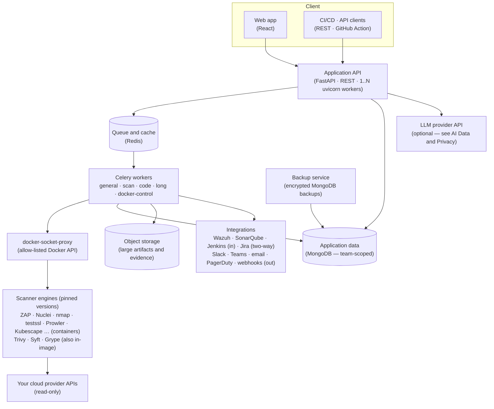
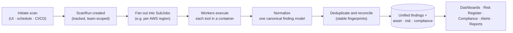

# Platform Architecture

This page explains how Offload Security is put together — the components, how a scan actually executes, where data lives, and how the SaaS and on-premises deployments differ. It complements the conceptual **[Data Lake & Single Pane of Glass](./introduction/unified-data-layer.mdx)**, which covers *why* everything shares one data model; this page covers *how* it runs.

## Components

At a high level, a browser talks to an API, heavy work runs on background workers, and everything reads and writes one shared set of data stores.

- **Application API (FastAPI).** Serves the web app and the REST API, enforces authentication, RBAC and per-team tenancy, and dispatches work. It runs as one process by default; since 1.4.0 the operator can run several uvicorn worker processes with `WEB_CONCURRENCY` (`auto` = up to 4, bounded by the container's CPU limit), with shared state such as rate limits held in Redis. The interactive API docs (Swagger / ReDoc) are on outside production and off when `ENVIRONMENT=production` unless `ENABLE_API_DOCS` is set.
- **Celery workers.** Long-running work runs on background workers, not in the request path, so the UI stays responsive. Work is queued through Redis to separate worker pools so one kind of work cannot starve another: a general worker, a cloud **scan** worker, a **code** worker (repositories, registries, Kubernetes), a **long** worker for multi-hour web scans, a small **docker-control** worker for the short Docker questions an API request waits on (is an image cached, cancel a scan container, lint a Dockerfile, verify a signature), and the beat scheduler.
- **Scanner tools.** Every engine runs at one pinned version, recorded on each run. OWASP ZAP, Nuclei, nmap, testssl.sh, Prowler, Kubescape and the other heavier engines run as **single-use, resource-capped sibling containers** torn down when the scan completes; Trivy, Syft and Grype also ship in the worker image.
- **Docker socket proxy.** The web backend holds no Docker socket. Workers reach Docker through `docker-socket-proxy`, which forwards only the Docker API calls the platform makes (no exec, build, volume or swarm calls). It narrows the Docker API surface; it does not sandbox the workers themselves.
- **Data stores.** Application data lives in MongoDB, partitioned into purpose-specific databases (platform, orchestration, vulnerability, native scans, knowledge base) and always scoped to a team. Large artifacts — raw tool output kept as scan evidence, frozen reports, uploaded evidence — go to mounted volumes or an S3-compatible bucket.
- **Backups.** A `backup` service takes scheduled MongoDB backups (every 24 hours and kept 14 days by default), encrypts them to the operator's `age` public key — it refuses to back up unencrypted unless explicitly allowed — and periodically restore-verifies the newest archive. See [Deployment & Operations](./on-premises/deployment.md).
- **External systems.** Cloud provider APIs are accessed with **read-only** credentials; integrations ingest or push data; the LLM provider is called only when AI features are enabled.

## How a scan executes

A scan is tracked as a `ScanRun` that fans out into `SubJobs`, which the workers execute in parallel and then normalize into findings.

Key properties:

- **Credentials are decrypted only inside the worker**, for the duration of the scan.
- **Findings are normalized** to one severity scale and shape regardless of which tool produced them, then **deduplicated** with stable fingerprints so re-scans update rather than duplicate.
- **Each run records what produced it** (provenance): the tool, engine and pinned version, settings, a redacted command line, exit code and UTC start and end times; for web, API and network scans the tool's raw output is kept with its SHA-256. Cloud, Kubernetes, container and code runs freeze their findings or report at completion, so a past run can be reported on and compared with another run later.
- **Exports are fingerprinted.** Issued reports carry a SHA-256 digest, are kept byte-for-byte, and can be checked later against what the platform issued.
- Terminal states are **Completed**, **Partial** (some jobs failed — usable but incomplete), **Failed**, or **Cancelled**. See [How Cloud Scans Run](./cloud-security/scan-orchestration.md).

## Deployment models

The same platform runs either as a managed service or entirely inside your environment.

| | **SaaS (managed)** | **On-premises / self-hosted** |
|---|---|---|
| **Where it runs** | Offload-operated cloud | A Docker Compose stack of prebuilt images on your host — see [Deployment & Operations](./on-premises/deployment.md). The agentic-fix services (`agent-launcher`, `agent-sandbox`, `agent-egress`, `celery-fix-worker`) start only under the `agentic-fix` Compose profile. |
| **Where your data lives** | Offload-managed stores, team-isolated | **Entirely within your environment** |
| **Cloud scanning** | Read-only, over the provider APIs | Same |
| **Internal network reach** | — | Internal hosts, private apps / APIs (once `ALLOW_PRIVATE_SCAN_TARGETS` is set), [Wazuh](./on-premises/wazuh-integration.md), Greenbone / OpenVAS |
| **AI features** | Call the external LLM provider (optional) | Call the external LLM provider (optional) — or **disable** them; see [AI Data & Privacy](./ai-threat-intelligence/ai-data-privacy.md) |

For internal-network coverage, ingestion and the on-prem architecture, see **[On-Premises](./on-premises/index.mdx)**.

:::note[Read-only by default]
Across both models, scans only ever **read** your environment using the read-only credentials you provide. The two places the platform can write are explicit and opt-in: the Auto-Fix Engine (approved actions, simulated until an operator sets `REMEDIATION_LIVE_EXECUTE=true`) and agent-written fix pull requests to your repositories (off by default — `AGENTIC_FIX_ENABLED` — run in a disposable sandbox whose only network exit is an egress proxy; a branch and a PR, never a merge).
:::

## Related

- **[Data Lake & Single Pane of Glass](./introduction/unified-data-layer.mdx)** — the shared data model behind every module.
- **[Trust & Security](./trust-and-security.md)** — encryption, tenant isolation, credential and secret handling.
- **[On-Premises](./on-premises/index.mdx)** — self-hosted and air-gapped deployment.
- **[AI Data & Privacy](./ai-threat-intelligence/ai-data-privacy.md)** — what AI features see and how to disable them.
