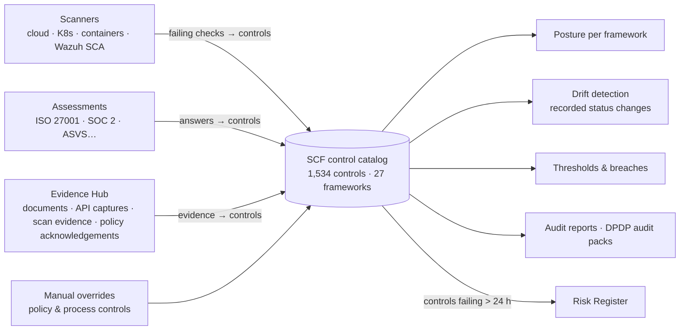

# Compliance & GRC

Compliance in Offload Security is not a spreadsheet you fill in before an audit. Every scanner in the platform, every assessment answer and every uploaded document lands on one control catalog — the **Secure Controls Framework (SCF)** — and each control is mapped to the requirements of **27 frameworks**. Implement a control once and every framework that references it moves; let a control slip and you see the regression the same day.

**Where:** left navigation → **Compliance Posture**, **Assessments**, **Audit Reports** and **DPDP Compliance** (all under *Compliance & Risk*).

## The four workspaces

| Workspace | What it is for | Pages |
| --- | --- | --- |
| **Compliance Posture** | The live picture: score per framework, every control's status, gap analysis, manual overrides, control test cadence. Four tabs: *Compliance Posture*, *Compliance Engine*, *Drift Detection*, *Evidence Hub*. | [Compliance Posture](./compliance-dashboard.md) · [Compliance Engine](./autonomous-compliance.md) · [Drift Detection](./drift-detection.md) · [Evidence Hub](./evidence-hub.md) |
| **Assessments** | Guided questionnaires for ISO 27001, SOC 2, OWASP ASVS 5.0, NIST CSF 2.0, SSDF, SAMM and more; answers feed control status. | [Assessments](./interactive-assessments.md) |
| **Audit Reports** | Attestable PDF and CSV reports (framework scores, controls, findings, drift, remediation, sync history), frozen at issue with a SHA-256 you can verify, plus the per-framework evidence bundle. | [Audit Reports](./audit-reports.md) |
| **DPDP Compliance** (beta) | India's Digital Personal Data Protection Act 2023 + Rules 2025 and CERT-In directions: readiness, DPIA, SDF classification, vendor due diligence, breach clocks, sealed audit packs. | [DPDP Act (India)](./dpdp-privacy.md) |

Policy acknowledgements are collected from the **Knowledge Base** and count as evidence; see [Policy Acknowledgement](./policy-attestation.md).

## How it fits together

- **Evidence decides status.** The compliance engine maps active scan failures to controls by check ID **every 4 hours**, after scans and on demand, then checks thresholds and runs drift detection in the same pass; a completed assessment maps its answers immediately. Scanner mappings that are derived rather than reviewed can only record gaps, never earn credit.
- **Every control carries a status and evidence.** Status is `implemented`, `partial`, `planned`, `not_implemented`, `not_assessed` or `not_applicable`; evidence is deduplicated so one artifact counts everywhere it applies, and only **current** evidence earns credit.
- **Every status is traceable.** The **Why this status** panel and the status-basis API show who or what set each status, when, and on what evidence. See [How control status is decided](./control-status.md).
- **Humans stay in control.** A status a person sets, such as a **manual override** with a justification, is never changed by automation; scan failures that contradict it are flagged for review. An **exception** records why a control cannot be met, with compensating controls and an expiry.

## How a framework score is calculated

Each control in scope for a framework contributes to that framework's percentage:

| Control state | Counts as |
| --- | --- |
| **Implemented** | 1.0 |
| **Partial** | 0.5 |
| **Not implemented** or **not assessed**, but with current linked evidence | 0.25 |
| **Not implemented** / **not assessed**, no evidence | 0 |
| **Not applicable** | Removed from the denominator |

An **implemented** control with open findings counts as **partial**. Evidence counts only while it is current: not expired, archived, revoked or superseded, and within its validity window.

The denominator is every in-scope control, so *not assessed* controls do count against you, which is why a fresh installation reads low and climbs as scans, assessments and overrides land. A framework with no assessed controls and no evidence-only credit is shown as *Not Assessed* rather than 0%. Where several frameworks are summarized in one figure, it is the average of the assessed frameworks.

The same implementation score is used on the Compliance Posture page, the dashboard, the executive view, the Compliance Engine's threshold checks and the audit reports.

## Start here

1. **Pick your frameworks.** A platform administrator activates the ones you report against from Compliance Posture → **Frameworks** tile (10 are active by default). Scores, evidence counts and thresholds are scoped to active frameworks.
2. **Let scans do the first pass.** Cloud, Kubernetes and container scans already map to controls; **Run Now** on the Compliance Engine tab runs the correlation now instead of waiting for the 4-hour cycle.
3. **Run one assessment end-to-end.** ISO 27001 or SOC 2 from the Assessments hub — the answers land on SCF controls the moment you complete it. See [Assessments](./interactive-assessments.md).
4. **Override what automation cannot see.** Policies, committees, training — set them from the gap analysis with a justification. See [Compliance Posture](./compliance-dashboard.md#manual-overrides).
5. **Set thresholds and watch drift.** A threshold per framework (default 70%) turns slippage into a breach; every recorded status change that goes the wrong way becomes a regression you can act on. See [Compliance Engine](./autonomous-compliance.md) and [Drift Detection](./drift-detection.md).
6. **Generate the audit pack.** [Audit Reports](./audit-reports.md) for an attestable PDF and CSVs plus the evidence bundle; the [DPDP module](./dpdp-privacy.md#audit--export) for the sealed DPDP pack.

## Prerequisites

- **View Assessments** to read compliance data; **Manage Assessments** to sync, run assessments, request and decide exceptions and publish policy acknowledgements; **admin** role (or an admin-scoped API key) to set manual overrides and thresholds; **Execute Remediations** for remediation actions; platform administrators activate frameworks and import the SCF catalog.
- At least one connected scanner ([Cloud Security](../cloud-security/index.md), [App & Infrastructure Scanning](../security-scanning/index.md)) — not required, but it is what makes the posture move on its own.

## Retention

| Record | Kept for | Setting |
| --- | --- | --- |
| Compliance audit log (hash-chained status changes, overrides, evidence links) | 5 years | `COMPLIANCE_AUDIT_LOG_RETENTION_DAYS` (1825) |
| Drift reports | 5 years | `COMPLIANCE_DRIFT_TTL_DAYS` (1825) |
| Daily / weekly posture snapshots | 90 days / 365 days; monthly snapshots are kept | `COMPLIANCE_SNAPSHOT_DAILY_RETENTION_DAYS`, `COMPLIANCE_SNAPSHOT_WEEKLY_RETENTION_DAYS` |
| Frozen Kubernetes compliance reports | 5 years | `COMPLIANCE_RETENTION_DAYS` (1825) |
| Issued audit report files | 180 days | `REPORT_RETENTION_DAYS` (`0` keeps them) |
| DPDP audit events | At least 365 days (configurable upward) | DPDP retention policy |

Evidence in the evidence store is not aged out by the retention sweep.

## Related

- [Supported Frameworks](./supported-frameworks.md) — the 27-framework catalog and how SCF mappings work.
- [Risk Management](../vulnerability-risk/risk-management/index.md) — a control that stays *not implemented* or *partial* for more than 24 hours is minted as a system risk (hourly sweep, one risk per control).
- [Reports & AI](../reports-and-ai/index.md) — executive and scheduled reporting.
