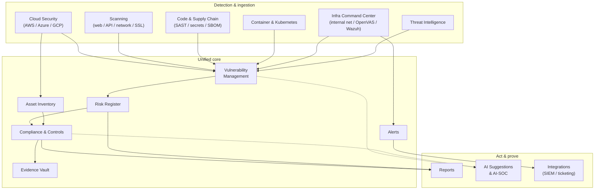

# Platform at a Glance

Offload Security is organized into modules that each own a domain of security work — and all feed the same correlated data model, or **[data lake](./unified-data-layer.mdx)**. This page is a map: what each module does, and where to read more. In the product, each module page also has a **Help** button with step-by-step task guides for that module.

## How the modules connect

Findings from every source converge in **Vulnerability Management**, resolve against the **Asset Inventory**, promote into the **Risk Register**, update **Compliance** controls, and generate **Evidence** and **Reports** — with **AI** assisting throughout and **Integrations** pushing to the systems you already run.

## The modules

### Detection & scanning

| Module | What it does | Read more |
|---|---|---|
| **Cloud Security (CSPM)** | Continuous misconfiguration assessment of AWS, Azure and GCP, identity and network analysis, real-time cloud events, a remediation queue. | [Cloud Security](../cloud-security/index.md) |
| **Scanning** | One module: **Assessments** (App Scan — an authenticated, graded web and API assessment), **Targeted runs** (OWASP ZAP, Nuclei, Nmap, testssl.sh, API discovery and others, one tool at a time) and **New scan**. Each run records its provenance and authorization and can be compared with the previous run. | [App & Infrastructure Scanning](../security-scanning/index.md) |
| **Code Command Center** | Static analysis, secrets detection, dependency (SCA) and IaC scanning of your repositories, pull / merge request review, and SARIF import from other scanners. | [API & Code Scanning](../security-scanning/code/index.md) |
| **SBOM & License Scanning** | Software bill-of-materials generation and open-source **license compliance** across code and container images. | [Container Security](../security-scanning/containers/index.md) |
| **Container Security** | Registry discovery and image scanning for ECR, Artifact Registry / GCR and ACR (through a connected cloud account); any other image, including Docker Hub, is scanned by reference. SBOMs, image policies and rollout tracking. | [Container Security](../security-scanning/containers/index.md) |
| **Kubernetes Security** | Cluster onboarding and scanning, a fleet heat map, grouped findings and compliance reports. | [Kubernetes Security](../security-scanning/kubernetes/index.md) |
| **Infra Command Center & On-Premises** | The whole platform self-hosted; network and private URL/API scanning of internal targets; Wazuh endpoint telemetry synced in (with an Endpoint 360 page per host); Greenbone OpenVAS results imported into Vulnerability Management — for assets that never leave your network. | [On-Premises](../on-premises/index.mdx) |

### Unify, prioritize & govern

| Module | What it does | Read more |
|---|---|---|
| **Vulnerability Management** | The unified queue: triage, risk scoring, deduplication, SLA tracking, approved risk exceptions, a case file per finding, and remediation guidance across every source. | [Vulnerability Management](../vulnerability-risk/vulnerability-management/index.mdx) |
| **Asset Inventory** | A live catalog of resources across clouds, accounts, regions, and the internal network. | [Asset Inventory](../cloud-security/asset-inventory.md) |
| **Risk Register** | An enterprise risk register auto-minted from findings, with treatment plans and SLAs. | [Risk Register](../vulnerability-risk/risk-management/index.md) |
| **Compliance & GRC** | Framework tracking over a catalog of 27 frameworks (SOC 2, ISO 27001, NIST CSF, PCI DSS, SEBI CSCRF, DPDPA and more), guided assessments, drift detection, and frozen, verifiable audit reports. | [Compliance](../compliance/index.md) |
| **Evidence Management** | An auditable evidence vault, captured as work happens and mapped to controls. | [Evidence Hub](../compliance/evidence-hub.md) |
| **Alerts** | Centralized, deduplicated alerting across sources, delivered to Slack, Teams, Google Chat, PagerDuty and webhooks, with a daily email digest. | [Alerts](../vulnerability-risk/alerts.md) |

### Act, prove & extend

| Module | What it does | Read more |
|---|---|---|
| **Reports** | Executive dashboard, scheduled reports and a catalog of exports (PDF, HTML, Word, CSV, XLSX) from live data. | [Reports & AI](../reports-and-ai/index.md) |
| **Knowledge Base** | A searchable store of policies, standards, and answers that powers questionnaire auto-fill and AI guidance. | [Knowledge Base](../ai-threat-intelligence/knowledge-base.md) |
| **Security Command Center** | The AI-assist view of the triage queue: agents that triage (rule-based, LLM-assisted when configured), prepare fix suggestions, correlate incidents and answer posture questions; an approval-gated Auto-Fix Engine (cloud actions simulated unless live execution is enabled). | [Security Command Center](../ai-threat-intelligence/ai-soc-agents.md) |
| **Threat Intelligence** | Eight built-in feeds (CISA KEV, URLhaus, OTX, Feodo Tracker, SSL Blacklist, Blocklist.de, Spamhaus DROP, OpenPhish), each fetched on its own interval; IOC correlation against your assets and findings, KEV-weighted CVE prioritization, ATT&CK coverage. | [Threat Intelligence](../ai-threat-intelligence/threat-intelligence.md) |
| **Integrations** | Slack, Teams, Google Chat, email and PagerDuty for alerts; Jira two-way ticketing, plus GitHub and GitLab Issues; Wazuh and Greenbone OpenVAS pulling findings in, SonarQube and Jenkins summaries; Splunk (HEC) and syslog / CEF forwarding; signed webhook subscriptions for any SIEM or automation. | [Integrations](../integrations/index.md) |

## Solutions by industry

Offload Security maps these modules to the outcomes specific sectors need — from PCI-DSS and audit evidence in **banking and financial services** to data-protection and internal-network coverage in **healthcare** and **manufacturing**. See **[Solutions by Industry](../industries/index.md)**.
