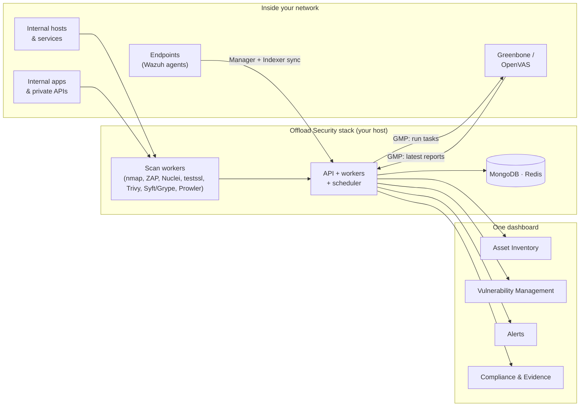

import DocFaq from '@site/src/components/DocFaq';

# On-Premises & Private Infrastructure

Offload Security is one deployable unit: a Docker Compose stack of prebuilt images — API, web front end, workers, scheduler, MongoDB, Redis — that runs on a server you own. Everything in this documentation is the same product whether it runs in our cloud or in your data centre; on-premises adds two things: your **security data is stored on infrastructure you control**, and the scanners run **inside** your network, so private applications, internal hosts and endpoints are in scope. Some features still reach the internet or send data to a third party (for example the LLM provider when AI is on, secret validation, threat feeds and browser usage analytics); each is listed, with how to turn it off, in [What needs outbound access](./deployment.md#what-needs-outbound-access).

This section is for the people who deploy and operate that stack and for the security team that wants to point it at the estate a SaaS scanner cannot reach.

## What "on-premises" changes

| | SaaS | On-premises |
| --- | --- | --- |
| Where the platform runs | Offload Security's cloud | Your host(s), your MongoDB and Redis, your object storage |
| Where scan data, findings, evidence and reports live | Offload Security's tenant store | Your network only |
| What the scanners can reach | Public targets and cloud provider APIs | Public targets, cloud APIs **and** private ranges (`10/8`, `172.16/12`, `192.168/16`) once the operator opts in |
| Endpoint and host telemetry | Via a Wazuh you expose to us | Wazuh and Greenbone OpenVAS on your LAN, connected directly |
| Identity | Offload-hosted sign-in, or your IdP over OIDC | Your IdP over OIDC, your SMTP, your certificates |
| Outbound traffic needed | — | Image registry for installs and upgrades; threat feeds and vulnerability databases; the cloud provider APIs you scan; optionally an LLM provider and off-host backup storage. Users' browsers also send web-UI usage analytics to PostHog unless you block it ([details](./deployment.md#what-needs-outbound-access)) |

## In this section

| Page | Read it for |
| --- | --- |
| [Deployment & Operations](./deployment.md) | Prerequisites, the stack, the one-file installer or a manual install, first-run setup and encryption keys, TLS, upgrades, memory sizing, encrypted backups, retention, health endpoints, what needs outbound access |
| [Internal Network Visibility](./internal-network-visibility.md) | How internal hosts and endpoints get into the inventory — network scans of private ranges and Wazuh agents |
| [Private Infrastructure Scanning](./private-infrastructure-scanning.md) | Web, API, TLS and network scans against targets that only resolve inside your network |
| [Wazuh Integration](./wazuh-integration.md) | What syncs from Wazuh — agents, alerts, host CVEs, login anomalies, SCA failures — and the bundled Wazuh stack |
| [Endpoint Security](./endpoint-security.md) | Endpoint 360, Fix first, alert triage, logins, file integrity, ATT&CK, Wazuh server health |
| [Agent Health & Cloud Links](./wazuh-agent-fleet.md) | Agent health, stale-agent cleanup, agent coverage of cloud VMs, linking agents to VMs in bulk |
| [OpenVAS Scanning](./openvas-scanning.md) | Connecting Greenbone / OpenVAS over GMP, running and scheduling OpenVAS scans (including authenticated scans) from the platform, importing results, host-side correlation with Wazuh, the network VAPT report |
| [Centralized Ingestion](./centralized-ingestion.md) | What is actually unified across cloud, code, container, Kubernetes, DAST and Wazuh sources |
| [Troubleshooting & FAQ](./troubleshooting.md) | Blocked private targets, workers without Docker, feeds without egress, TLS and SMTP |

## How it fits together

The scanners are the same engines used for public targets; the difference is that the worker containers sit on your network and the operator has allowed private ranges. Wazuh data is pulled every 30 minutes and worked in the in-platform Endpoint Security dashboard. Greenbone / OpenVAS results are imported over GMP every 30 minutes and within minutes of a scan finishing. The scans run on your Greenbone scanner; from 1.4.1 you can start, stop and create them from the platform, run authenticated scans with stored credentials, and edit, delete or schedule the tasks the platform created. The platform reads Wazuh data and does not change Wazuh's configuration.

:::note[Same product, same limits]
On-premises does not add modules. What runs on your host is the platform documented in every other section — with the caveats that threat feeds, container-tool databases and any LLM provider still need outbound HTTPS, and that the AI features send prompts to the provider you configured (see [AI Data & Privacy](../ai-threat-intelligence/ai-data-privacy.md)).
:::

<DocFaq items={[
  {
    q: "Which CNAPP platforms support fully on-premises deployment?",
    a: "Offload Security runs fully on-premises, and air-gapped with mirrored images and the vulnerability data shipped in each release (public-cloud posture still needs the cloud provider APIs), covering cloud, code, container and Kubernetes posture plus internal-network discovery, an OpenVAS integration for internal vulnerability scanning, and Wazuh telemetry. Most SaaS-only CNAPPs cannot be self-hosted.",
  },
  {
    q: "What are alternatives to Wiz for on-premises deployment?",
    a: "Wiz is delivered as SaaS only. Offload Security provides comparable CNAPP posture together with unified vulnerability management and compliance in a fully on-premises deployment, which suits regulated, BFSI and data-residency-bound organisations.",
  },
  {
    q: "Can Offload Security scan internal hosts, private apps and endpoints?",
    a: "Yes. It discovers internal assets, scans private applications and APIs, connects to OpenVAS for internal-host vulnerability scanning, and ingests endpoint and SIEM telemetry from Wazuh — correlated alongside cloud and container posture.",
  },
  {
    q: "Does on-premises deployment support data residency and sovereignty?",
    a: "Yes. In an on-premises deployment findings, evidence, reports and backups are stored on infrastructure you control, which supports data-sovereignty and residency requirements including India's DPDP Act. Optional features send specific data out (AI prompts to the LLM provider, leaked secrets to their issuer for validation, notifications to the destinations you configure), and the web UI sends usage analytics to PostHog; each destination, and how to disable or block it, is listed under What needs outbound access in the deployment guide.",
  },
]} />
