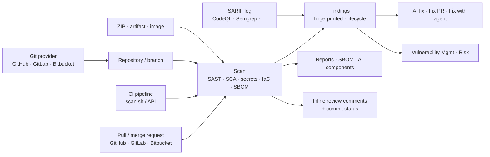

# Code Command Center

The Code Command Center is where source code gets tested before it becomes a running system: static analysis, vulnerable dependencies, leaked secrets, infrastructure-as-code mistakes, and the licences you are shipping. Connect a Git provider once, then scan repositories on demand, on a schedule, or from every pipeline run — and work the findings with a lifecycle that survives re-scans.

**Where:** left navigation → **Code Command Center**.

## What you get

| Scan type | Engine | Finds |
| --- | --- | --- |
| **SAST** | OpenGrep + Bandit (+ SonarQube when connected) | Injection, insecure deserialization, weak crypto, dangerous calls — per file and line, with code context |
| **Dependency / SCA** | OSV.dev, enriched with CISA KEV and EPSS | Vulnerable packages across lockfiles (npm, pip, Go, Maven, …), with fixed versions and exploit-likelihood signals |
| **Secrets** | Gitleaks + live validation | API keys, tokens, passwords and private keys in code, config **and git history** — each checked against its provider to tell a live credential from a rotated one |
| **IaC** | Checkov | Terraform, CloudFormation, Kubernetes manifests, Dockerfiles — public buckets, open security groups, unencrypted storage |
| **SBOM & Licences** | Syft (CycloneDX), licence enrichment via deps.dev | Component inventory, licence families and obligations, policy-pack checks |
| **Compiled Image Scan** | Trivy + Grype | The Docker image a pipeline just built |

**Full Code Security** runs SAST, SCA, secrets, IaC and SBOM & licences in one pass; the compiled image scan is a separate source on **New Scan**. All three rule-based engines also run your own [custom rules](./custom-rules.md).

## The workspace

| Tab | Use it to | Page |
| --- | --- | --- |
| **Overview** | Repository coverage — total, scanned, scheduled, not covered — findings by severity, and cards (top repositories by severity, coverage decay, most active, stale) that each open the full ranked list. | *this page* |
| **New Scan** | Scan a repository, an uploaded ZIP, a container image or a build artifact, and manage scheduled repository scans. | [Running Code Scans](./running-code-scans.md) |
| **Findings** | Triage across repositories: SAST, secrets, dependency CVEs and IaC grouped by rule or by fix, with lifecycle states and bulk decisions. | [Findings & Reports](./findings-and-reports.md) |
| **Upgrade Impact** | Dependency upgrades ranked by how many vulnerabilities each resolves. | [Upgrade Impact](./upgrade-impact.md) |
| **Suppressions** | What is hidden, since when and until when — by rule, with revoke. | [Findings & Reports](./findings-and-reports.md#suppressions) |
| **SARIF Imports** | Bring in results from CodeQL, Semgrep or any other SARIF 2.1.0 scanner. | [SARIF Imports](./sarif-imports.md) |
| **Reports** | Scan history by repository → branch → run; each run's frozen report, PDF export and AI analysis. | [Findings & Reports](./findings-and-reports.md#scan-reports) |
| **SBOM & Licenses** | Generate or upload SBOMs, licence governance, CycloneDX / SPDX / VEX exports, fix plans. | [SBOM & Licences](./sbom-and-licenses.md) |
| **Automation** | **Git Connections**, **PR Review** settings and the team quality gate, **GitHub App**, **CI/CD Pipeline** generation. | [Connecting Repositories](./connecting-repositories.md) · [Pull Request Review](./pull-request-review.md) · [CI/CD & Automation](./ci-cd-and-automation.md) |

## How it flows

Every finding a scan's tools report is stored as its own record. The only per-scan limit is a sanity ceiling of 50,000 findings (`CODE_FINDINGS_MAX`); a scan that reaches it says so on the scan and in its PDF.

Findings are **fingerprinted** (rule + file + code context, or package + CVE), so a re-scan updates the same finding instead of creating a new one, and a triage decision — triaged, risk accepted with an owner and justification, false positive — carries forward. Decisions are scoped to the repository they were made in unless you apply them to every repository ([scope](./findings-and-reports.md#scope-this-repository-or-every-repository)).

Pull and merge requests get a review of their own: only the changed files, new findings separated from pre-existing ones, comments on the diff and a commit status pinned to the exact commit — see [Pull Request Review](./pull-request-review.md).

## Prerequisites

- **Run Scans** to scan; **Execute Remediations** to open fix pull requests (manually or with an [agent](./agentic-fixes.md)).
- A Git provider token with repository read access — see [Connecting Repositories](./connecting-repositories.md). Uploaded ZIPs and artifacts need no connection.

## Related

- [Pull Request Review](./pull-request-review.md) · [Secret Detection](./secret-detection.md) · [SARIF Imports](./sarif-imports.md) · [Upgrade Impact](./upgrade-impact.md) · [Custom Rules](./custom-rules.md) · [Fix with Agent](./agentic-fixes.md) — the deeper pages of this section.
- [Pull Request Scanning](./pull-request-scanning.md) — every PR/MR scanned on its changed files, diffed against the base branch.
- [CLI & CI/CD](../../cli-and-cicd.md) — the `scan.sh` script, the CLI and release gates.
- [Container Security](../containers/index.md) — the images your code becomes.
- [Vulnerability Management](../../vulnerability-risk/vulnerability-management/index.mdx) — code findings in the unified view with SLAs.
