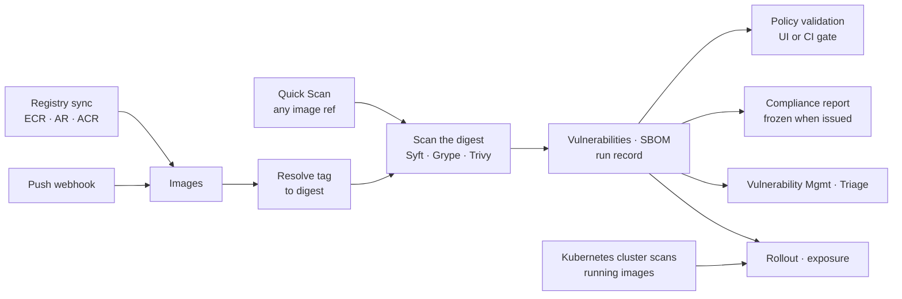

# Container Security

Container Security covers the images you build and pull: the registries they live in, the vulnerabilities inside them, the Dockerfiles that produce them, the policies that decide whether they may deploy, where they run in your clusters, and the SBOMs and compliance evidence you keep about them.

**Where:** left navigation → **Container Security**.

## What you get

| Capability | Detail |
| --- | --- |
| **Registry connections** | AWS ECR, Google Artifact Registry (and legacy GCR) and Azure Container Registry, through a cloud account you have already connected. Images are synced, browsed and scanned in place. |
| **Image scanning** | Registry scans run **Syft** (SBOM) plus two vulnerability engines, **Grype** and **Trivy**, against one resolved image digest. **Quick Scan** scans any image reference the platform can pull. |
| **Dockerfile scanning** | 14 native rules plus Hadolint — root user, `latest` tags, secrets in `ENV`, `ADD` from URLs, missing `HEALTHCHECK` — graded before the image is built. |
| **Image policies** | Maximum critical/high counts, image age and (from templates) allowed registries, blocked `latest` and required labels — validated in the UI or from CI with one call. |
| **Registry webhooks** | Signed push events queue a scan of the pushed image: ECR (via SNS), Artifact Registry/GCR, or a generic sender that signs its deliveries. ACR and Docker Hub do not sign their own deliveries — see [Governance](./governance.md). |
| **Rollout** | Where an image runs in your onboarded Kubernetes clusters, matched by digest, and whether a fixed build has replaced the old one everywhere. |
| **SBOM lifecycle** | Generate CycloneDX, SPDX or Syft JSON SBOMs per image, keep them, download them. |
| **Compliance reports** | CIS Docker Benchmark 1.6, NIST 800-53, PCI DSS and SOC 2 per image, registry or account. Each report is frozen when issued. |
| **Coverage** | Registries scanned / scheduled / uncovered / stale, same model as Cloud Security. A registry whose scans failed does not count as covered. |

:::note[Other registries]
Docker Hub, Harbor, Quay, GitLab, JFrog and other registries cannot be added as registry connections in 1.4.0. Scan their images one at a time by reference with **Quick Scan** (or from CI); only images the platform can pull without signing in can be scanned that way. See [Registries — Supported registries](./registries.md#supported-registries).
:::

## The workspace

| Tab | Use it to | Page |
| --- | --- | --- |
| **Coverage** | See registry coverage and where findings concentrate. | *this page* |
| **Cloud Registries** | Add registries, sync and browse images, scan them, review drift. | [Registries](./registries.md) |
| **Quick Scan** | Scan any image reference on demand. | [Image Scanning](./image-scanning.md) |
| **Scan Results** | Open results, read vulnerabilities and fixes, export. | [Image Scanning](./image-scanning.md#reading-a-result) |
| **Dockerfile Scan** | Paste a Dockerfile and get graded findings. | [Image Scanning](./image-scanning.md#dockerfile-scanning) |
| **Image Policies** | Define and validate image policies. | [Policies, Webhooks, SBOM & Compliance](./governance.md#image-admission-policies) |
| **Webhooks** | Auto-scan on push. | [Policies, Webhooks, SBOM & Compliance](./governance.md#registry-webhooks) |
| **SBOM** | Generate and manage SBOMs. | [Policies, Webhooks, SBOM & Compliance](./governance.md#sbom-lifecycle) |
| **Compliance** | Generate container compliance reports. | [Policies, Webhooks, SBOM & Compliance](./governance.md#compliance-reports) |
| **Rollout** | Check where an image runs and whether a fix has rolled out. | [Image Rollout](./rollout.md) |

**Schedule Scans** in the page header opens the Unified Scheduler.

## How it flows

## Prerequisites

- **Manage Container Security** to add registries, create policies and run scans; **View Scans** to read results.
- For cloud registries: a connected cloud account with pull permission on the registry — `ecr:GetAuthorizationToken` + read (in `ReadOnlyAccess`) on AWS, `roles/artifactregistry.reader` on GCP, `AcrPull` on Azure — see [Required Permissions — Container registries](../../cloud-security/permissions.md#container-registries).

## Related

- [Scan Records & Evidence](./scan-evidence.md) — what each container scan records, comparing two scans, verifiable exports.
- [Kubernetes Security](../kubernetes/index.md) — the clusters those images run in.
- [Code Command Center](../code/index.md) — scan the image you just built in CI with **Compiled Image Scan**.
- [Vulnerability Management](../../vulnerability-risk/vulnerability-management/index.mdx) — SLA tracking for image CVEs.
