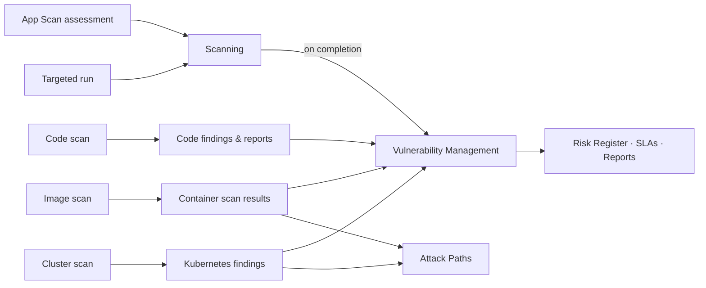

# App & Infrastructure Scanning

Cloud Security tells you how your accounts are configured. This section covers everything you **build and run** on top of them: the web apps and APIs you expose, the hosts behind them, the container images you ship, the Kubernetes clusters they run in, and the source code they came from. Each area has its own workspace, but every result becomes a finding with a severity, an affected resource and a fix, and flows into the same triage, risk and reporting pipeline.

## The five workspaces

| Workspace | Where | What you scan | Engines |
| --- | --- | --- | --- |
| **[Scanning](./native-scans.md)** | **Scanning** → **Assessments** · **Targeted runs** · **New scan** | URLs, APIs, hosts, networks, TLS endpoints, domains | OWASP ZAP, Nuclei, Nmap, testssl.sh, native header / API / fingerprint / recon analyzers |
| **[Code Command Center](./code/index.md)** | **Code Command Center** | Git repositories, uploaded archives, build artifacts | OpenGrep + Bandit (SAST), OSV.dev (SCA), Gitleaks (secrets), Checkov (IaC), Syft + Grype (SBOM / images), SonarQube (integration) |
| **[Container Security](./containers/index.md)** | **Container Security** | Images in Amazon ECR, Google Artifact Registry and Azure Container Registry; Dockerfiles | Trivy, Grype, Syft, native Dockerfile rules |
| **[Kubernetes Security](./kubernetes/index.md)** | **Kubernetes Security** | EKS / GKE / AKS / on-prem clusters | Trivy, Polaris, Kubescape, kube-hunter (kube-bench does not apply to clusters scanned over the API and is reported as skipped) |
| **[Infra Command Center](./infra-command-center.md)** | **Infra Command Center** | CI pipelines, WAF rules, API endpoints under load | CI/CD API keys, WAF test suite, load tester |

**Scanning** is one module in 1.4.0. Its **Assessments** tab holds App Scan, the graded multi-tool DAST assessment of one application ([Run an App Scan](./app-scan.md)); **Targeted runs** holds single-tool runs such as one Nmap or testssl.sh scan ([Scan Results](./scan-results.md)); **New scan** is the one launcher for both. The other four workspaces keep their own results views and also feed the unified views.

## How it fits together

1. **Scan** — from the UI, on a schedule, or from CI (`scan.sh`, the CLI, or the API).
2. **Finding** — every engine's output is normalized, deduplicated across runs, and kept with its history; your triage decisions (resolved, false positive, suppressed) survive re-scans. A finished Scanning run is sent to Vulnerability Management as soon as it completes, not on the next periodic sweep.
3. **Risk** — findings roll into [Vulnerability Management](../vulnerability-risk/vulnerability-management/index.mdx) for SLA tracking and into the [Risk Register](../vulnerability-risk/risk-management/index.md) when they need an owner.
4. **Report** — per-scan HTML / PDF / Word reports, consolidated reports across scans, a [network / infrastructure VAPT report](./network-scans.md#network-vapt-report), and compliance mappings (OWASP, ASVS, NIST SSDF and others).

Every Scanning run also records how it was produced and under what authorization — see [Engagement & Evidence](./scan-evidence.md).

## Start here

| If you want to… | Go to |
| --- | --- |
| Test a web application or API, with login, before release | [Run an App Scan](./app-scan.md) |
| Run one tool against a target (ZAP, Nuclei, testssl.sh, headers, recon) | [Running Web, API & Host Scans](./native-scans.md) |
| Port-scan hosts and produce a network VAPT report | [Network Scans & VAPT Report](./network-scans.md) |
| Compare a run with the last one, download reports, prove what was issued | [Scan Results](./scan-results.md) · [Engagement & Evidence](./scan-evidence.md) |
| Scan a repository or wire scans into CI | [Connecting Repositories](./code/connecting-repositories.md) → [Running Code Scans](./code/running-code-scans.md) → [CI/CD & Automation](./code/ci-cd-and-automation.md) |
| Scan the images in your registries | [Registries](./containers/registries.md) → [Image Scanning](./containers/image-scanning.md) |
| Assess a cluster | [Onboarding Clusters](./kubernetes/onboarding-clusters.md) → [Scanning & Findings](./kubernetes/scanning-and-findings.md) |
| Schedule scans | [Scan Management & Scheduling](./scan-management.md) |
| Automate over REST | [Scanning API](./api.md) |

:::warning[Only scan what you own]
Web, API, network and load tests send real traffic to the target, and an authenticated scan acts as the account you give it. Run them only against systems you own or are explicitly authorized to test, and use the gentler profiles on production. The launcher asks you to confirm that authorization for App Scan, ZAP, Nuclei, Nmap and testssl.sh runs and records it with the scan.
:::

## Prerequisites

- Platform permissions: **Run Scans** to start scans, **View Scans** to read results, **Manage Container Security** for registries, policies and clusters ([RBAC](../authentication/rbac-team-management.md)).
- Private (RFC 1918) scan targets are refused unless the deployment sets `ALLOW_PRIVATE_SCAN_TARGETS=true`. Loopback and cloud-metadata addresses are always refused.
- For registries and clusters discovered from the cloud: a connected account ([Connecting Cloud Accounts](../cloud-security/connecting-accounts.md)) with the roles in [Required Permissions](../cloud-security/permissions.md).
- For repositories: a Git provider token (GitHub, GitLab or Bitbucket) with read access.
