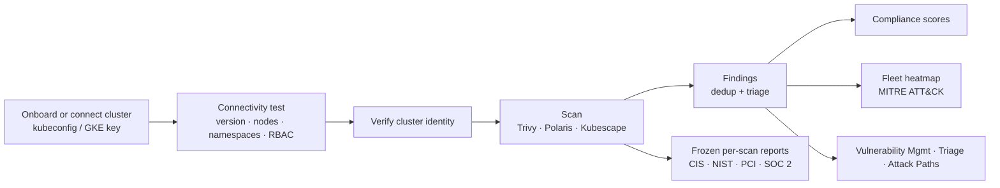

# Kubernetes Security

Kubernetes Security assesses your clusters for risky workloads, over-permissive RBAC, network exposure and vulnerable images — then shows the result per cluster, across the fleet, and mapped to the **MITRE ATT&CK Containers** matrix and to compliance frameworks. It works for managed clusters (Amazon EKS, Google GKE, Azure AKS) and other Kubernetes clusters, always with **read-only** access over the Kubernetes API.

**Where:** left navigation → **Kubernetes Security**.

## What you get

| Capability | Detail |
| --- | --- |
| **Read-only onboarding** | A self-contained kubeconfig, or for GKE a service-account key. Managed clusters found on connected cloud accounts are listed as **Discovered — not connected** and connected in one click. |
| **Least-privilege RBAC profiles** | Generated `ClusterRole` scripts — **Minimal** (no Secrets, no ConfigMaps) or **Extended** (adds ConfigMaps; never Secrets). |
| **Multi-engine scans** | **Trivy** (workload misconfigurations and image vulnerabilities), **Polaris** (workload best practices) and **Kubescape** (all controls, including NSA-CISA, MITRE and CIS mappings). |
| **Honest scope** | Every scan states what it did not assess — CIS control-plane and node sections, failed scanners, denied namespaces — and never counts those as passed. |
| **Findings with triage** | Severity, affected resource, scanner, remediation; statuses **Open / Resolved / Suppressed / False Positive** that survive re-scans. Workload exposure feeds the triage score. |
| **Fleet heatmap** | Every cluster by severity plus the MITRE ATT&CK container tactics your findings map to. |
| **Compliance posture** | Per-cluster scores and grades for **CIS, NIST 800-53, PCI DSS and SOC 2** (HIPAA over the API). Each scan's reports are frozen as the point-in-time record. |
| **Coverage** | Connected clusters scanned, scheduled, uncovered or stale, plus discovered clusters not yet connected and any discovery source that is missing. |

:::note[What scans do not cover]
Clusters are scanned remotely through the Kubernetes API. **CIS Kubernetes Benchmark sections 1–4** (control plane, etcd, node and kubelet configuration) need kube-bench running on a node, so they are **not tested** in 1.4.0 and are reported as *not assessed*. See [Scanning & Findings — What a scan does not cover](./scanning-and-findings.md#not-covered).
:::

## The workspace

| Tab | Use it to | Page |
| --- | --- | --- |
| **Coverage** | See scanned / scheduled / uncovered clusters, discovered clusters and missing sources. | [Compliance & Fleet Posture](./compliance-and-fleet.md#coverage) |
| **Clusters** | Add or connect clusters, test and scan them, open a cluster's findings or dashboard. | [Onboarding Clusters](./onboarding-clusters.md) |
| **Fleet Heatmap** | Compare clusters by severity and MITRE tactic. | [Compliance & Fleet Posture](./compliance-and-fleet.md#fleet-heatmap) |
| **Findings** | Filter and triage every finding across clusters. | [Scanning & Findings](./scanning-and-findings.md) |
| **Compliance** | Read per-cluster framework scores and generate reports. | [Compliance & Fleet Posture](./compliance-and-fleet.md) |
| **RBAC Profiles** | Choose the scanner's access level and generate the deployment script. | [Onboarding Clusters](./onboarding-clusters.md#rbac-profiles) |

**Schedule Scans** (top right) opens the Unified Scheduler to set recurring cluster scans — see [Scan Management & Scheduling](../scan-management.md).

## How a cluster scan flows

## Prerequisites

- **Network reachability** from the platform to the cluster API server. There is no in-cluster agent.
- **Read-only credentials** bound to one of the [RBAC profiles](./onboarding-clusters.md#rbac-profiles). Cloud IAM alone does not grant in-cluster read — apply the `ClusterRole` from [Required Permissions — Bucket B](../../cloud-security/permissions.md#bucket-b--kubernetes-in-cluster-rbac).
- Platform permission **Manage Container Security** to onboard and scan; **View Scans** to read.

## Related

- [Container Security](../containers/index.md) — the images running in your clusters, and [where they run](../containers/rollout.md).
- [Attack Path Analysis](../../cloud-security/attack-paths.md) — cluster findings and namespaces become nodes in the security graph.
- [Vulnerability Management](../../vulnerability-risk/vulnerability-management/index.mdx) — SLA tracking for Kubernetes findings.
