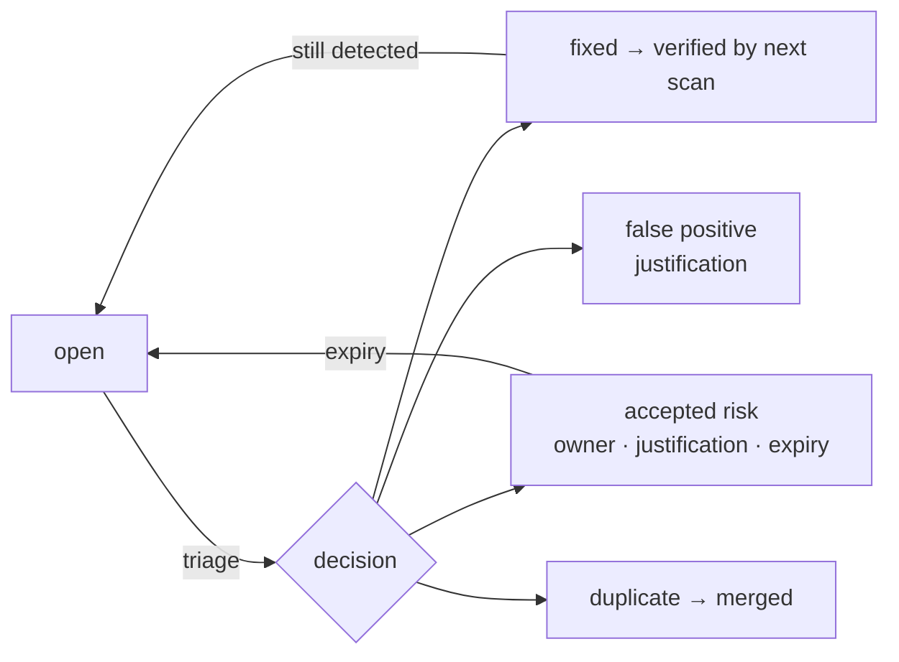

import DocFaq from '@site/src/components/DocFaq';

# Vulnerability Management

Vulnerability Management is the single place where findings from **every** source are triaged, prioritised and tracked to *verified* closure. Cloud misconfigurations, Kubernetes findings, container CVEs, web and API scan results, code findings and Wazuh detections arrive already normalised and deduplicated, so your team works one queue instead of six consoles.

**Where:** left navigation → **Vulnerability Management** (under *Core Security*).

## What arrives here

| Source filter | Fed by |
| --- | --- |
| **Cloud Misconfig** | Cloud Security posture scans (AWS / GCP / Azure) and real-time cloud events |
| **Kubernetes** | Polaris, Kubescape, Trivy and kube-hunter cluster scans (kube-bench is skipped for clusters scanned remotely over the API) |
| **Container CVEs** | Registry and quick-scan image results (Trivy / Grype) |
| **App Scans** | ZAP, Nuclei, Nmap, testssl, header and API tests from the Scanning workspace |
| **Code** · **IaC** | SAST, SCA, secrets and Checkov findings from the Code Command Center |
| **API** · **Domain** | API security tests and domain reconnaissance |
| **Wazuh** | Vulnerabilities in installed packages reported by the agents of a connected Wazuh manager; the chip appears only once Wazuh is connected |

Each source is **fingerprinted** — the same weakness on the same asset is one finding whether it came from two tools or two weeks apart — and enriched with **CISA KEV**, **EPSS**, CVSS, reachability and the asset's business context before it reaches you.

## The workspace

| Tab | What it is | Page |
| --- | --- | --- |
| **Triage** | The Triage Engine's queue: work items ranked P1–P4, the *Action queue* (P1 + P2) by default, bulk decisions, remediation guidance. | [Triage Queue](./triage.md) |
| **Suppressions** | Everything hidden by a triage decision or rule exception, with its expiry; revoke from here. | [Triage Queue](./triage.md#suppressions) |
| **Risk exceptions** | Formally requested and separately approved, time-limited exceptions for single findings. | [Risk Exceptions](./risk-exceptions.md) |
| **Raw findings** | Every unique vulnerability grouped across assets, filterable by source, severity and status; expand for description, remediation and affected assets. | [Raw Findings & Occurrences](./raw-findings.md) |
| **Analytics** | Counts by severity, source and status, SLA breaches, recent vulnerabilities. | [Analytics](./dashboard.md) |
| **All Occurrences** | The flat list — one row per finding per asset — with VPR, priority, SLA due and per-occurrence detail. | [Raw Findings & Occurrences](./raw-findings.md#all-occurrences) |
| **SLA Policies** | Remediation deadlines by severity/environment/criticality, breach dashboard, escalation. | [SLA Management](../sla-management.md) |
| **Jira** | Appears once a Jira integration is configured: tickets created from findings and their sync state. | [Third-Party Integrations](../../integrations/third-party.md) |

**Score findings** (top right of Triage) runs the Triage Engine over the team's open findings; it also runs automatically after syncs, and **Sync All Sources** pulls the latest results from every module on demand.

Triage, Raw findings and All Occurrences are views of the **same findings**: a status set on an occurrence is written through to the deduplicated finding first, so the two cannot drift, and a decision made in one view shows in the others, in the Security Command Center's Triage Center and in reports. When a team hides the Triage queue from its menu, the Triage and Suppressions tabs are hidden too; Risk exceptions stays.

## The lifecycle

A finding starts **open**. Your decisions — **fixed**, **accepted risk**, **false positive**, **duplicate**, **suppressed** — are recorded on the finding and survive re-scans. An accepted risk always has a review date — 90 days by default (`ACCEPTED_RISK_DEFAULT_EXPIRY_DAYS`) when none is given — and reopens for review when it passes. When a later scan no longer reports the weakness the finding is **resolved by scan**; when a scan reports something you had marked fixed, it **reopens**. A closed Jira ticket is never treated as proof: closure is confirmed by the scanner, not the tracker.

## Upgrade Impact

For package vulnerabilities the useful question is often *which upgrade closes the most?* The **Upgrade Impact** view answers it from these same open findings: per package it shows the current version, the recommended version (and a major-version alternative), how many vulnerabilities the upgrade resolves by severity, what remains and why, the affected assets, and a copyable package-manager command. One engine computes these numbers wherever they appear. Findings under an approved risk exception are left out and counted.

| Where | Covers |
| --- | --- |
| Code Command Center → **Upgrade Impact** tab, and the SBOM and Fix Plan views | Application dependencies on each repository's default branch (npm, PyPI, Maven, Go, NuGet, RubyGems, Cargo, Composer and others) |
| Endpoint Security → **Fix first** → **By upgrade**, and each host's Endpoint 360 | Linux packages on Wazuh agents (needs **View Integrations**) |

Wazuh does not report a fixed version for host packages, so for Linux the platform looks up each open package vulnerability in the distribution's own advisories through [OSV.dev](https://osv.dev) every 6 hours (Ubuntu, Debian, Alpine, Red Hat Enterprise Linux, Rocky Linux, AlmaLinux, SUSE and openSUSE). It recommends only a version that advisory names — it never invents one.

:::note[Limits of host patch guidance]
Upgrade Impact recommends versions; it does not deploy patches to hosts. Windows and macOS hosts and unsupported or unidentified Linux releases get no fixed version (they are shown as such, not as zero), there is no Microsoft KB mapping, and OpenVAS network-scan findings are not part of this view. Extended-support streams that need a subscription (Ubuntu Pro, SUSE LTSS) are not recommended.
:::

See [SBOM & Licenses](../../security-scanning/code/sbom-and-licenses.md) and [Wazuh](../../integrations/wazuh.md) for those screens.

## Prerequisites

- **View Scans** to read; **Manage Triage** to score findings and record decisions.
- Findings appear after the first scans complete in [Cloud Security](../../cloud-security/index.md) or [App & Infrastructure Scanning](../../security-scanning/index.md).

## Related

- [SLA Management](../sla-management.md) — deadlines, breaches, escalation.
- [Alerts](../alerts.md) — being told when something new needs attention.
- [Risk Management](../risk-management/index.md) — promoting findings into owned business risks.

<DocFaq items={[
  {
    q: "How should security teams deduplicate vulnerability findings?",
    a: "Offload normalizes findings from every source into a shared model and reconciles duplicates automatically, so the same issue reported by different scanners collapses into a single tracked finding in one queue.",
  },
  {
    q: "How does Offload Security prioritize vulnerabilities?",
    a: "Findings are risk-scored using exploit and threat signals such as EPSS and CISA KEV together with asset and business context, so teams focus on what is genuinely exploitable and important rather than raw CVSS alone.",
  },
  {
    q: "How do you validate vulnerability closure after a Jira ticket is resolved?",
    a: "A resolved ticket is not treated as proof a vulnerability is fixed. Offload confirms closure when a subsequent scan no longer detects the finding, so remediation is verified rather than assumed.",
  },
]} />
